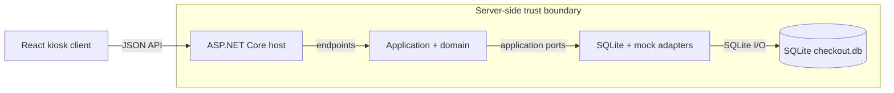
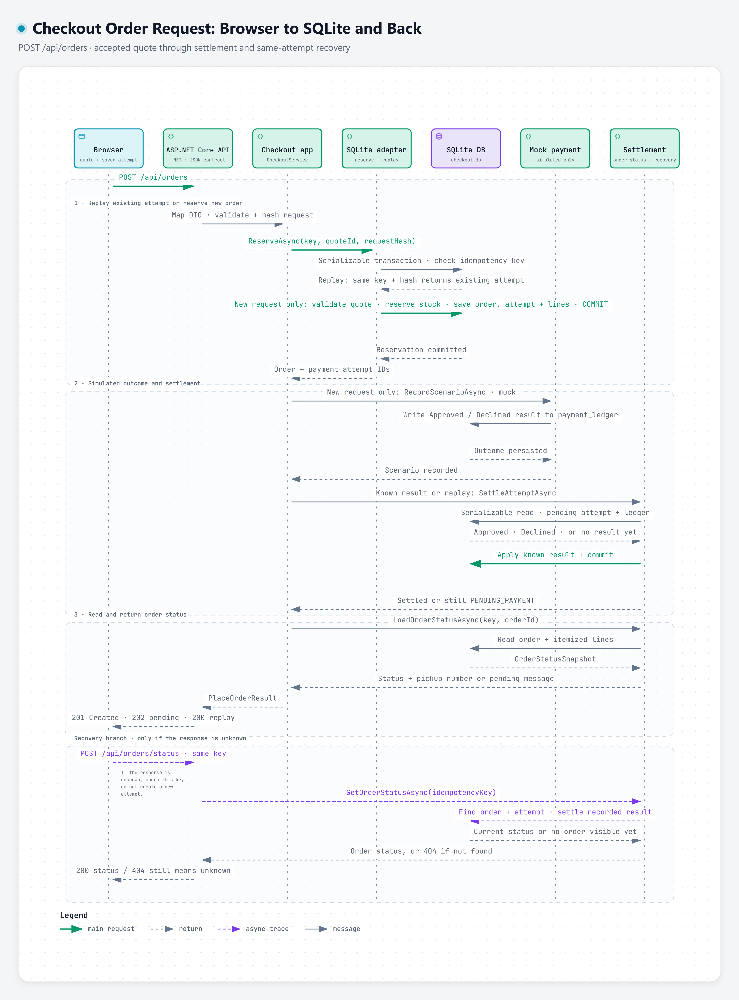

# Good Table self-service checkout

[](https://github.com/FirasAyari/self-service-checkout/actions/workflows/ci.yml)

A tablet-friendly checkout demo for a small lunch counter. The React client calls a .NET 10 API; the API owns menu prices, quotes, stock reservations, order state, and pickup numbers. Outcomes are simulated. The checkout collects no payment details and never contacts a payment provider.

## Run locally on Windows, macOS, or Linux

Requirements: .NET 10 SDK, Node.js 22.14 or later, and npm. GNU Make is optional. The repository's `global.json` selects .NET SDK 10.0.100 with feature-band roll-forward. The commands below use the repository wrapper so Windows can use the user-local SDK when the system `dotnet` does not meet `global.json`.

From the repository root, restore the .NET tools and solution, install the browser client dependencies, then build both applications:

```sh
node scripts/dotnet.mjs tool restore
node scripts/dotnet.mjs restore backend/SelfServiceCheckout.slnx
npm ci --no-audit --prefix frontend
node scripts/dotnet.mjs build backend/SelfServiceCheckout.slnx --configuration Release
npm run build --prefix frontend
```

Dependency auditing is a separate explicit check below; installation skips npm's duplicate implicit audit request.

Start the API and React development server together:

```sh
npm run dev --prefix frontend
```

Open [http://127.0.0.1:5173](http://127.0.0.1:5173). The API listens on `http://localhost:5080`; Vite proxies `/api` requests there. Readiness is available at `http://localhost:5080/healthz`. The API creates `data/checkout.db` in the repository root. Stop both processes with Ctrl+C.

To run only the API, use this command instead of the combined development command:

```sh
node scripts/dotnet.mjs run --project backend/src/SelfServiceCheckout/SelfServiceCheckout/SelfServiceCheckout.csproj --launch-profile http
```

## Run tests and checks

Audit the frontend and .NET dependencies for known vulnerabilities:

```sh
npm audit --prefix frontend --audit-level=low
node scripts/dotnet.mjs list backend/SelfServiceCheckout.slnx package --vulnerable --include-transitive
```

Run the backend test projects, React unit tests, delivery checks, and architecture boundary checks:

```sh
node scripts/run-tests.mjs
```

Run the frontend tests alone or build the production frontend bundle:

```sh
npm test --prefix frontend
npm run build --prefix frontend
```

Run checkout browser journeys and the ASP.NET production-host browser check. Install Chromium once if Playwright asks for it:

```powershell
npx --prefix frontend playwright install chromium
node scripts/run-e2e.mjs
```

Check acceptance-criterion test tags:

```powershell
node scripts/traceability.mjs --strict
```

If you have GNU Make, `make setup` runs the same .NET tool restore, solution restore, and frontend dependency installation steps. GNU Make is optional and is not required for local setup or verification.

On Unix with GNU Make, the short path after cloning is `make setup`, then `make dev`; open `http://127.0.0.1:5173`. Run `node scripts/dev-smoke.mjs` to verify that the Unix development entry point serves both the API and Vite client. Run `make check` for the build, tests, lint, architecture checks, and strict acceptance trace.

The development smoke script uses Make. On Windows, start the combined development command above, leave it running, then open a second PowerShell terminal and check both endpoints directly:

```powershell
$api = Invoke-WebRequest -Uri 'http://localhost:5080/healthz' -UseBasicParsing
$ui = Invoke-WebRequest -Uri 'http://127.0.0.1:5173/' -UseBasicParsing
if ($api.StatusCode -ne 200 -or $ui.StatusCode -ne 200) { throw 'The API and UI must both return HTTP 200.' }
"API: HTTP $($api.StatusCode); UI: HTTP $($ui.StatusCode)"
```

Both requests should return HTTP 200. Stop the combined development command with Ctrl+C.

## Run with Docker

With Docker Compose installed, run:

```sh
docker compose up --build
```

Open [http://127.0.0.1:8080](http://127.0.0.1:8080). The image builds the React app and serves it from the ASP.NET Core host. SQLite data persists in the `checkout-data` Docker volume. The container runs as a non-root user and uses simulated approval only; it does not connect to a payment provider.

Stop the foreground command with Ctrl+C, or run `docker compose down` from another terminal. The named volume remains, so local orders persist when the container is started again.

To run the isolated container smoke check, which builds the image, checks the oversized-request limit, places a demo order, restarts the container, checks that the order identity persists, and removes its temporary container and volume, run:

```sh
node scripts/docker-smoke.mjs
```

The Docker build, readiness check, packaged assets, oversized-request rejection, simulated order, and restart persistence passed locally on October 21, 2026 using port 18081. Docker CLI is unavailable in the current verification environment, so I could not rerun the Docker path locally on recent commits. GitHub Actions [run #35](https://github.com/FirasAyari/self-service-checkout/actions/runs/39805355076) passed the Docker smoke and all other CI jobs on source commit `8d942c1`, after [run #33](https://github.com/FirasAyari/self-service-checkout/actions/runs/39802832149) passed on application commit `4ec7caf`. Earlier successful Docker runs include [39776458035](https://github.com/FirasAyari/self-service-checkout/actions/runs/39776458035), [39705234675](https://github.com/FirasAyari/self-service-checkout/actions/runs/39705234675), [39710070884](https://github.com/FirasAyari/self-service-checkout/actions/runs/39710070884), [39713154967](https://github.com/FirasAyari/self-service-checkout/actions/runs/39713154967), and [39713813535](https://github.com/FirasAyari/self-service-checkout/actions/runs/39713813535).

The Docker smoke uses port 18080 by default; if another service already uses it, set `CHECKOUT_SMOKE_PORT` to a free port. The CI workflow includes both the Unix development smoke and Docker smoke. The smoke checks require a working .NET/Node toolchain and Docker respectively.

Current application-code verification (`0efaad1`, 2026-10-22): the local product runner passed Domain 19/19, API 49/49, frontend 45/45, delivery 8/8, and architecture boundary checks. Frontend lint and production build passed; the browser suite passed 36/36 checkout journeys and 3/3 Production-host checks; strict traceability reported 50 criteria, with 48 required criteria covered by named tests and AC-Y1/AC-Y2 documented as deviations. GitHub Actions [run #40](https://github.com/FirasAyari/self-service-checkout/actions/runs/39817065459) passed all jobs on `577f7ca`, including backend build/tests, frontend checks and Docker smoke, and browser checkout journeys. The docs-only commit records the same verified application code. Docker is unavailable in the current local Windows environment.

## Build and verification

Vitest and Playwright/axe suites cover the current acceptance criteria. The API's OpenAPI contract is committed at [openapi.v1.json](backend/tests/SelfServiceCheckout.Api.Tests/Contracts/openapi.v1.json). The strict trace command reports documented deviations separately and fails when a required criterion lacks an AC-tagged test. See [the live trace table](docs/traceability.md) for current gaps and [the scenario catalog](docs/scenarios.md) for planned behavior.

## Checkout demo

Browse categories and add items, then choose **Review order**. Cold brew offers server-priced sizes and add-ons; selected options appear in the quote and order receipt. The server returns a short-lived quote in integer cents; the customer sees that total before placing the demo order. In Development, the review screen offers four simulated outcomes: approve, decline, approved with delayed confirmation, or remain unknown. These options exercise checkout state handling. They do not represent real card processing.

If the response is interrupted, the UI checks the same idempotency key and keeps the customer on the attempt. An unresolved result remains pending and retains its stock reservation; it is never treated as a decline just because a lookup has no result. The cart's item IDs, selected option IDs, and quantities are kept in `sessionStorage` so a tab reload can restore it; a pending attempt stores only its key, quote ID, and mock scenario. No payment data is collected or stored. Idle reset and paid completion clear the cart.

The paid receipt includes a printable itemized view and an offline QR code containing its displayed reference, pickup number, and total. Scanning the QR opens no external service.

After 60 seconds without activity, the browser shows a warning with options to keep the order or start fresh. It resets the session 15 seconds later unless continued. Paid confirmation resets after 30 seconds. An unresolved payment is not automatically cleared.

The checkout does not ask for a card number, expiry, security code, or token. In Development, a separate simulated-outcome selector exercises approval, decline, delayed confirmation, and unknown outcomes. No payment provider is contacted.

The original plan card-entry criteria AC-Y1 and AC-Y2 are intentionally out of scope under ADR-0002. AC-D7 covers the revised flow with no credential collection.

### Development-only demo controls

Open `http://127.0.0.1:5173/admin` while the Vite Development server is running to edit the demo catalog, configure simulated payment and failure behavior, or reset local demo data. The UI requires the admin token, keeps it in memory only, and asks for confirmation before reset. The API must run in Development with `DemoMode:Enabled=true` and `DemoMode:AdminToken` of at least 32 characters; both settings are off/empty by default. Follow [demo-mode instructions](docs/demo-mode.md) to enable it. Never commit the token or expose these controls as a production admin surface.

## Architecture

- The backend is a modular monolith with one HTTP host and one SQLite store. The domain and application projects have no ASP.NET Core, EF Core, or SQLite dependency.
- `backend/src/Checkout.Domain` owns pure cart limits, money, tax, and order transition rules.
- `backend/src/SelfServiceCheckout/SelfServiceCheckout.Application` owns checkout workflows, application records, and narrow ports for catalog reads, quotes, order placement, outcome settlement, and demo administration. It has no dependency on HTTP DTOs.
- `backend/src/SelfServiceCheckout/SelfServiceCheckout.Infrastructure.Sqlite` implements those ports, database transactions, migrations, and durable mock payment outcomes.
- `backend/src/SelfServiceCheckout/SelfServiceCheckout.Contracts` contains versioned HTTP DTOs. Only the API host maps these to application models; the browser validates responses at the network boundary.
- `backend/src/SelfServiceCheckout/SelfServiceCheckout` contains the ASP.NET Core composition root, HTTP endpoints, contract mapping, HTTP error mapping, and hosted reconciliation loop. Endpoints do not query EF entities directly.
- `frontend/src/checkout` separates reducer/session state, presentation helpers, checkout screens, cart actions, kiosk session behavior, and payment UI; `App.tsx` composes those flows.
- `scripts/architecture-boundaries.test.mjs` guards project references and prevents framework/storage references from entering Domain or Application and persistence references from leaking into the HTTP host. `backend/tests` and `frontend` contain the behavior suites.

### Runtime architecture

The source-linked [interactive Archify diagram](.archify/architecture-self-service-checkout-20261021/checkout-architecture.html) and its [editable JSON source](.archify/architecture-self-service-checkout-20261021/candidate.json) were generated from repository commit `c7b2bcae4a5c7e7304c6d5460065372ec0cdc6a4`.



### Checkout order request

This Archify sequence follows `POST /api/orders` from the React browser through the .NET endpoint, application service, atomic SQLite reservation, simulated outcome, settlement, and response. It starts after a server-priced quote is accepted; the final lane shows recovery with the same idempotency key when the original response is unknown.

[](.archify/sequence-checkout-request-20261021-165052/checkout-request.html)

[Open the interactive Archify diagram](.archify/sequence-checkout-request-20261021-165052/checkout-request.html) · [Watch the six-second trace](.archify/sequence-checkout-request-20261021-165052/checkout-request.webm) · [View its editable JSON source](.archify/sequence-checkout-request-20261021-165052/candidate.json)

- `data/checkout.db` is local runtime data and is ignored by Git. SQLite is configured for the single-location demo, not multi-instance production traffic.

Development enables mock outcomes for local demonstrations. In Production, set `Checkout:MockPaymentsEnabled=true` only for a visibly labeled demo kiosk; the customer cannot choose an outcome and the server always returns the standard simulated approval. Neither mode contacts a provider or takes money. Development-only admin/demo controls are disabled by default and require explicit configuration; they are not a production management workflow. No real payment gateway, production admin UI, cashier workflow, customer accounts, order fulfillment screen, refunds, or multi-location support is included. The configured business time zone defaults to UTC and must be set for the operating location before a kiosk trial.

See the [single-kiosk deployment and operations runbook](docs/production-kiosk-runbook.md) for hosting limits, environment configuration, release steps, backup and restore, and the production checklist. Physical kiosk and deployment validation is out of scope for this simulated-payment, single-host submission; passing automated tests does not establish readiness for a real kiosk.

## Review record

See the [technical design](docs/TDD.md) for the system architecture, checkout flow, and decision rationale; the [brief-to-repository crosswalk and evidence matrix](docs/submission-requirements-matrix.md), [business rules](docs/business-rules.md), [scenario catalog](docs/scenarios.md), and [plan review](docs/plan-review.md) for requirements, reviewed behavior, and deliberate scope changes. [Architecture decisions](docs/adr/README.md), [AI workflow](docs/ai-workflow.md), [rejected/deferred decisions](docs/rejected.md), and the [reconstructed timeline](docs/timeline.md) preserve context without claiming a prompt-by-prompt history. Review documents supplied with the assignment describe intended work; their delivery or publication instructions do not authorize external publication.
