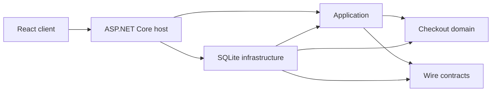

# Goodtable self-service checkout

[](https://github.com/FirasAyari/self-service-checkout/actions/workflows/ci.yml)

A tablet-friendly checkout demo for a small lunch counter. The React client calls a .NET 10 API; the API owns menu prices, quotes, stock reservations, order state, and pickup numbers. Outcomes are simulated. The checkout collects no payment details and never contacts a payment provider.

## Run locally on Windows, macOS, or Linux

Requirements: .NET 10 SDK, Node.js 22.14 or later, and npm. GNU Make is optional. The repository's `global.json` selects .NET SDK 10.0.100 with feature-band roll-forward. The commands below use the repository wrapper so Windows can use the user-local SDK when the system `dotnet` does not meet `global.json`.

From the repository root, restore the .NET tools and solution, install the browser client dependencies, then build both applications:

```powershell
node scripts/dotnet.mjs tool restore
node scripts/dotnet.mjs restore backend/SelfServiceCheckout.slnx
npm ci --prefix frontend
node scripts/dotnet.mjs build backend/SelfServiceCheckout.slnx --configuration Release
npm run build --prefix frontend
```

Start the API and React development server together:

```powershell
npm run dev --prefix frontend
```

Open [http://127.0.0.1:5173](http://127.0.0.1:5173). The API listens on `http://localhost:5080`; Vite proxies `/api` requests there. Readiness is available at `http://localhost:5080/healthz`. The API creates `data/checkout.db` in the repository root. Stop both processes with Ctrl+C.

To run only the API, use this command instead of the combined development command:

```sh
node scripts/dotnet.mjs run --project backend/src/SelfServiceCheckout/SelfServiceCheckout/SelfServiceCheckout.csproj --launch-profile http
```

## Run tests and checks

Run the backend test projects, React unit tests, delivery checks, and architecture boundary checks:

```powershell
node scripts/run-tests.mjs
```

Run the frontend tests alone or build the production frontend bundle:

```powershell
npm test --prefix frontend
npm run build --prefix frontend
```

Run checkout browser journeys and the ASP.NET production-host browser check. Install Chromium once if Playwright asks for it:

```powershell
npx --prefix frontend playwright install chromium
node scripts/run-e2e.mjs
```

Check acceptance-criterion test tags:

```powershell
node scripts/traceability.mjs --strict
```

If you have GNU Make, `make setup` runs the same .NET tool restore, solution restore, and frontend dependency installation steps. GNU Make is optional and is not required for local setup or verification.

## Run with Docker

With Docker Compose installed, run:

```sh
docker compose up --build
```

Open [http://127.0.0.1:8080](http://127.0.0.1:8080). The image builds the React app and serves it from the ASP.NET Core host. SQLite data persists in the `checkout-data` Docker volume. The container runs as a non-root user and uses simulated approval only; it does not connect to a payment provider.

Docker Compose is included, but Docker was unavailable in the environment used to prepare this submission, so the container path has not been run or verified here. When Docker is available, the `docker compose up --build` command above is the documented start command; the `checkout-data` volume persists local demo data.

## Build and verification

Vitest and Playwright/axe suites cover the current acceptance criteria. The API's OpenAPI contract is committed at [openapi.v1.json](backend/tests/SelfServiceCheckout.Api.Tests/Contracts/openapi.v1.json). The strict trace command reports documented deviations separately and fails when a required criterion lacks an AC-tagged test. See [the live trace table](docs/traceability.md) for current gaps and [the scenario catalog](docs/scenarios.md) for planned behavior.

## Checkout demo

Browse categories and add items, then choose **Review order**. Cold brew offers server-priced sizes and add-ons; selected options appear in the quote and order receipt. The server returns a short-lived quote in integer cents; the customer sees that total before placing the demo order. In Development, the review screen offers four simulated outcomes: approve, decline, approved with delayed confirmation, or remain unknown. These options exercise checkout state handling. They do not represent real card processing.

If the response is interrupted, the UI checks the same idempotency key and keeps the customer on the attempt. An unresolved result remains pending and retains its stock reservation; it is never treated as a decline just because a lookup has no result. The cart's item IDs, selected option IDs, and quantities are kept in `sessionStorage` so a tab reload can restore it; a pending attempt stores only its key, quote ID, and mock scenario. No payment data is collected or stored. Idle reset and paid completion clear the cart.

The paid receipt includes a printable itemized view and an offline QR code containing its displayed reference, pickup number, and total. Scanning the QR opens no external service.

After 60 seconds without activity, the browser shows a warning with options to keep the order or start fresh. It resets the session 15 seconds later unless continued. Paid confirmation resets after 30 seconds. An unresolved payment is not automatically cleared.

The checkout does not ask for a card number, expiry, security code, or token. In Development, a separate simulated-outcome selector exercises approval, decline, delayed confirmation, and unknown outcomes. No payment provider is contacted.

The original plan card-entry criteria AC-Y1 and AC-Y2 are intentionally out of scope under ADR-0002. AC-D7 covers the revised flow with no credential collection.

### Development-only demo controls

Catalog changes, demo reset, and server-side mock/chaos overrides are available only when `DemoMode:Enabled=true` is set in Development and `DemoMode:AdminToken` contains at least 32 characters. Both settings are off/empty by default. See [demo-mode instructions](docs/demo-mode.md); never commit the token or expose these controls as a production admin surface.

## Architecture

- The backend is a modular monolith with one HTTP host and one SQLite store. The domain and application projects have no ASP.NET Core, EF Core, or SQLite dependency.
- `backend/src/Checkout.Domain` owns pure cart limits, money, tax, and order transition rules.
- `backend/src/SelfServiceCheckout/SelfServiceCheckout.Application` owns checkout workflows, provider-neutral records, and narrow ports for catalog reads, quotes, order placement, outcome settlement, and demo administration.
- `backend/src/SelfServiceCheckout/SelfServiceCheckout.Infrastructure.Sqlite` implements those ports, database transactions, migrations, and durable mock payment outcomes.
- `backend/src/SelfServiceCheckout/SelfServiceCheckout.Contracts` contains versioned HTTP DTOs. The API host checks inbound JSON and the browser validates responses at the network boundary.
- `backend/src/SelfServiceCheckout/SelfServiceCheckout` contains the ASP.NET Core composition root, HTTP endpoints, HTTP error mapping, and hosted reconciliation loop. Endpoints do not query EF entities directly.
- `frontend/src/checkout` separates reducer/session state, presentation helpers, checkout screens, and payment UI; `App.tsx` coordinates browser effects and user actions.
- `scripts/architecture-boundaries.test.mjs` guards project references and prevents framework/storage references from entering Domain or Application and persistence references from leaking into the HTTP host. `backend/tests` and `frontend` contain the behavior suites.



- `data/checkout.db` is local runtime data and is ignored by Git. SQLite is configured for the single-location demo, not multi-instance production traffic.

Development enables mock outcomes for local demonstrations. In Production, set `Checkout:MockPaymentsEnabled=true` only for a visibly labeled demo kiosk; the customer cannot choose an outcome and the server always returns the standard simulated approval. Neither mode contacts a provider or takes money. Development-only admin/demo controls are disabled by default and require explicit configuration; they are not a production management workflow. No real payment gateway, production admin UI, cashier workflow, customer accounts, order fulfillment screen, refunds, or multi-location support is included. The configured business time zone defaults to UTC and must be set for the operating location before a kiosk trial.

See the [single-kiosk deployment and operations runbook](docs/production-kiosk-runbook.md) for hosting limits, environment configuration, release steps, backup and restore, and on-device checks. Passing automated tests does not prove the target kiosk is ready for customer use.

## Review record

See [the business rules](docs/business-rules.md), [scenario catalog](docs/scenarios.md), and [plan review](docs/plan-review.md) for requirements, reviewed behavior, and deliberate scope changes. [Architecture decisions](docs/adr/README.md), [AI workflow](docs/ai-workflow.md), [rejected/deferred decisions](docs/rejected.md), and the [reconstructed timeline](docs/timeline.md) preserve context without claiming a prompt-by-prompt history. Review documents supplied with the assignment describe intended work; their delivery or publication instructions do not authorize external publication.
